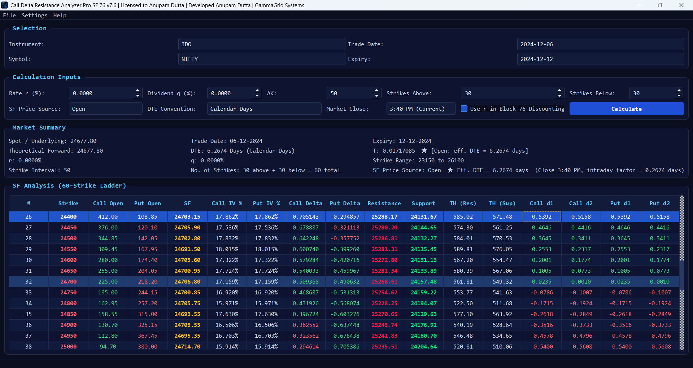
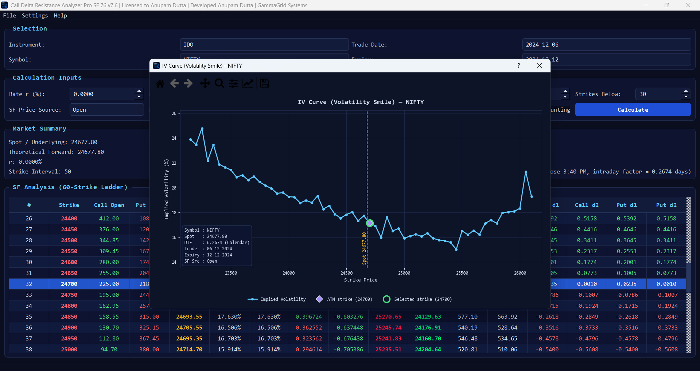

I am **Anupam Dutta**. This is not a blog -- this is a Quant Research Lab.

Trading is not just what I do. It is how I think.

I didn't start in the markets. For over a decade, I worked as a mechanical engineer at multinational companies, solving technical problems and managing complex systems. But I wanted something different : the ability to make decisions and live with their outcomes.

In April 2019, I committed fully to the Indian equity index options market, with Nifty50 as my primary arena.

---

## What I Built

My research focuses on:

- Open Interest shifts
- Implied Volatility structure
- Volatility surface behavior
- Dealer positioning and gamma flows

Over time, this evolved into a structured framework:

---

### CDRA Tool (Call Delta Resistance Analyzer Pro SF 76)

I developed the **CDRA Tool** (Call Delta Resistance Analyzer Pro SF 76) as a proprietary options analytics engine built around independent Synthetic Future (SF) modeling and Black-76 pricing.

Unlike conventional models that project a single underlying forward across all strikes, CDRA derives an **independent Synthetic Future** (`SF = Strike + Call - Put`) for every strike along the option chain. By isolating localized supply-demand dynamics and put-call parity deviations, the engine computes high-precision Black-76 Implied Volatilities, Delta exposures, Resistance & Support levels, Theoretical Range (TH), and Delta Price boundaries.

  
  
CDRA Pro SF 76 — Multi-Strike Synthetic Futures &amp; Black-76 Greeks Analysis

#### Key Architectural Capabilities:

- **Multi-Source Price Modeling**: Computes pricing, Greeks, and volatility boundaries across **LTP**, **Close / Settlement**, and **Open** price sources.
- **Intraday Time Mechanics**: When analyzing Open prices, the engine incorporates an intraday session fraction based on market close (3:40 PM current / 3:30 PM legacy), ensuring positive time-to-expiry and mathematically rigorous pricing across all tenors and 0 DTE expiry days.
- **Universal BhavCopy Parser**: Native compatibility with modern NSE UDiFF CSV formats as well as legacy F&O BhavCopies, with automatic cash settlement spot extraction on expiry day.
- **Strike Projections &amp; Envelopes**: Deep strike diagnostics mapping the complete SF spectrum (Open, High, Low, LTP, Close), Synthetic Extremes IVs (CE at SF High, PE at SF Low with Put High), bullish/bearish extension ladders, and delta-weighted theoretical valuations.
- **Interactive Volatility Smile**: Integrated real-time IV Curve (Volatility Smile) with hover snap, ATM indicators, and spot alignment.

  
  
CDRA Pro SF 76 — Detailed Strike Projections, Volatility Boundaries &amp; Option Extensions

---

The system is intended for advanced option traders, quantitative researchers, and derivatives professionals. To make practical use of its outputs, users should have a sound understanding of:

- Black-76 / Black-Scholes option pricing
- Synthetic Futures and Put-Call Parity dynamics
- Implied Volatility skew and smile structure
- Option Greeks and dynamic dealer hedging
- Indian F&O market microstructure

For traders who wish to understand the underlying mathematical framework and its practical application, I also conduct a structured training program covering the theory, quantitative concepts, and real-market implementation behind the model.

---

## Philosophy

I don't believe in prediction.

I believe in:

- Understanding what is priced in
- Identifying where pressure builds
- Acting only when asymmetry is visible

Markets cannot be mastered. But a process can be built.

---

## Contact

**Anupam Dutta**

📧 [dutta.anupam.02@gmail.com](mailto:dutta.anupam.02@gmail.com)
☎️ +91-8240775462
