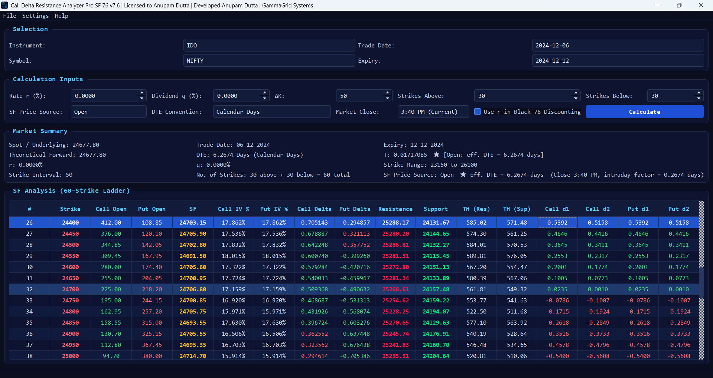
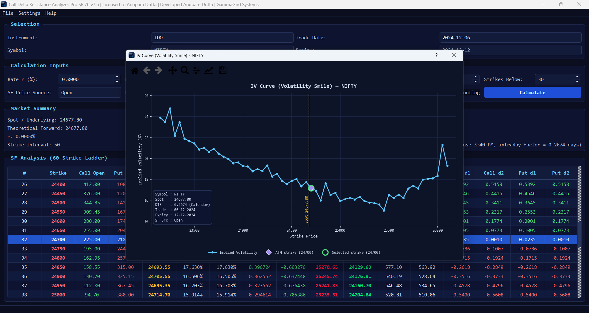

  

    
      PROPRIETARY QUANT ENGINE
    
    
      BLACK-76 PRICING
    
    
      INDEPENDENT SYNTHETIC FUTURES
    
    
      WINDOWS 10 / 11 (64-BIT)
    
  

  

    <strong>CDRA 76 Pro</strong> (<em>Call Delta Resistance Analyzer Pro SF 76</em>) is an institutional-grade desktop quantitative options analytics engine built around independent Synthetic Future (SF) modeling and Black-76 derivatives pricing. Engineered for professional derivatives traders, quants, and options analysts, CDRA reconstructs option chain pricing dynamics by isolating localized supply-demand friction, put-call parity dislocations, and true strike-by-strike forward valuations.
  

  

    <a href="https://drive.google.com/file/d/1Cg03ClvNiZLI1YZseHjvE78d1vAmztN7/view?usp=drive_link" target="_blank" rel="noopener noreferrer"
       style="display: inline-flex; align-items: center; gap: 8px; background: linear-gradient(135deg, #0284c7 0%, #0369a1 100%); border: 1px solid #38bdf8; color: #ffffff; padding: 10px 22px; border-radius: 6px; text-decoration: none; font-family: monospace; font-size: 14px; font-weight: bold; box-shadow: 0 0 16px rgba(56,189,248,0.4); transition: 0.2s;">
      <svg height="18" width="18" viewBox="0 0 24 24" fill="none" stroke="currentColor" stroke-width="2" stroke-linecap="round" stroke-linejoin="round" style="vertical-align: middle;">
        <path d="M21 15v4a2 2 0 0 1-2 2H5a2 2 0 0 1-2-2v-4"></path>
        <polyline points="7 10 12 15 17 10"></polyline>
        <line x1="12" y1="15" x2="12" y2="3"></line>
      </svg>
      Download CDRA 76 Pro
    </a>

    <a href="#requirements"
       style="display: inline-flex; align-items: center; gap: 8px; background: rgba(15,23,42,0.8); border: 1px solid rgba(56,189,248,0.3); color: #38bdf8; padding: 10px 18px; border-radius: 6px; text-decoration: none; font-family: monospace; font-size: 14px; transition: 0.2s;">
      System &amp; Licensing Requirements ↓
    </a>
  

<!-- ================= SCREENSHOT 1 ================= -->

  

    
  

  

    CDRA Pro SF 76 — Multi-Strike Synthetic Futures, Greeks Decomposition &amp; Delta Resistance/Support Ladder
  

---

## The Quantitative Framework

Standard option pricing engines make a simplifying assumption: they project a single underlying forward price uniformly across every strike along the option chain. In real market conditions, however, market makers and institutional desks face distinct localized inventory constraints, liquidity pools, and gamma exposures.

**CDRA 76 Pro departs fundamentally from conventional models:**

$$\text{SF} = \text{Strike} + \text{Call Price} - \text{Put Price}$$

By deriving an **independent Synthetic Future (SF)** for every strike, CDRA isolates localized put-call parity deviations and structural order book imbalances. 

Using this localized forward foundation, the engine deploys a specialized **Black-76 model** to compute:
- High-precision **Black-76 Implied Volatilities (IV)**
- Dynamic **Delta exposures** and dealer hedging sensitivity
- Deterministic **Resistance &amp; Support boundary levels**
- **Theoretical Range (TH)** and extreme price envelopment
- **Delta Price boundaries** indicating structural tail risks

---

## Key Architectural Capabilities

  

    

      [ 1. MULTI-SOURCE PRICE MODELING ]
    

    

      Computes pricing, Greeks, and volatility boundaries across three distinct price sources: <strong>LTP (Last Traded Price)</strong>, <strong>Close / Settlement</strong>, and <strong>Open</strong> price matrices. Compare historical closing structure against opening auctions and real-time intraday pricing.
    

  

  

    

      [ 2. INTRADAY TIME MECHANICS &amp; 0 DTE ]
    

    

      When analyzing Open prices, the mathematical engine incorporates an intraday session fraction based on market close (3:40 PM current / 3:30 PM legacy), guaranteeing positive time-to-expiry and mathematically rigorous pricing across all tenors, including 0 DTE expiry sessions.
    

  

  

    

      [ 3. UNIVERSAL BHAVCOPY PARSER ]
    

    

      Native, high-speed ingestion of modern NSE UDiFF CSV formats as well as legacy F&amp;O BhavCopies. Automatically parses contracts, dates, open interest shifts, and performs cash-settlement spot extraction on expiry day with zero manual data cleansing.
    

  

  

    

      [ 4. STRIKE PROJECTIONS &amp; EXTENSIONS ]
    

    

      Deep strike diagnostics map the entire SF spectrum across Open, High, Low, LTP, and Close. Computes Synthetic Extremes IVs (CE at SF High, PE at SF Low with Put High), bullish/bearish extension ladders, and delta-weighted theoretical valuations.
    

  

  

    

      [ 5. REAL-TIME VOLATILITY SMILE ]
    

    

      Integrated, interactive IV Curve (Volatility Smile) with hover snap inspection, At-The-Money (ATM) indicators, and spot alignment. Instantly visualizes volatility skew, smile asymmetries, and surface dislocations across all active strikes.
    

  

  

    

      [ 6. RESISTANCE &amp; SUPPORT DISCOVERY ]
    

    

      Calculates structural call delta resistance and put delta support zones where dealer hedging flows compress or accelerate market movement. Eliminates subjective charting in favor of deterministic option boundary mathematics.
    

  

<!-- ================= SCREENSHOT 2 ================= -->

  

    
  

  

    CDRA Pro SF 76 — Detailed Strike Projections, Volatility Boundaries, Synthetic Extremes &amp; Option Extensions
  

---

<h2 id="requirements">System Requirements &amp; Prerequisites</h2>

### Operating System Requirements
- **Supported OS**: Windows 10 (64-bit) or Windows 11 (64-bit)
- **Architecture**: 64-bit operating system (x64-based processor)
- **Memory (RAM)**: 4 GB minimum (8 GB or more recommended for heavy BhavCopy historical parsing)
- **Display Resolution**: 1920 × 1080 (Full HD) or higher recommended for optimal multi-column ladder display

### Quantitative Prerequisites
CDRA 76 Pro is engineered for institutional desks, quantitative researchers, and disciplined options traders. To derive maximum actionable edge from its output, users should have solid foundational knowledge of:
- Black-76 and Black-Scholes option pricing frameworks
- Synthetic Futures dynamics and Put-Call Parity equilibrium
- Implied Volatility (IV) smile, skew structure, and term structure
- Second-order Option Greeks and dynamic dealer gamma positioning
- Indian F&amp;O market microstructure and settlement conventions

---

## Licensing &amp; Subscription

> [!IMPORTANT]
> CDRA 76 Pro is a licensed proprietary software terminal. An **active monthly subscription** is required to use the software and receive ongoing analytical updates.

### Licensing Architecture:
- **Machine-Locked License**: Each license is assigned to a specific user and tied to the authorized machine's unique hardware identifier (HWID).
- **Monthly Subscription Required**: An active monthly subscription is required for software operation, BhavCopy data processing validation, engine enhancements, and license key renewals.
- **Onboarding &amp; Activation**: Upon downloading and installing the terminal, you will be prompted for your registered License Key. 

To initiate a subscription or request license activation, please contact directly:

📧 **Email**: [dutta.anupam.02@gmail.com](mailto:dutta.anupam.02@gmail.com)  
☎️ **Phone / WhatsApp**: +91-8240775462  
💬 **Threads**: [@gammagrid](https://www.threads.net/@gammagrid)

---

## Installation &amp; Setup Guide

1. **Download**: Click the download button below to retrieve the official CDRA 76 Pro package.
2. **Extract**: Extract the downloaded ZIP archive to a dedicated folder on your local drive (e.g., `C:\CDRA76Pro` or Desktop).
3. **Execute**: Launch the main executable (`.exe`).
4. **License Activation**: On initial startup, enter your registered email and the provided license key to validate your active monthly subscription.

> [!NOTE]
> **Windows Defender / SmartScreen Notice**:  
> Because CDRA 76 Pro is a specialized quantitative trading executable, Windows SmartScreen may present a security prompt on initial launch. If prompted, simply click **"More info"** followed by **"Run anyway"**.

---

  

    OFFICIAL DESKTOP RELEASE
  

  <h3 style="margin-top: 0; margin-bottom: 12px; color: #f8fafc; font-size: 22px;">
    Download CDRA 76 Pro
  </h3>
  

    Get the latest release of Call Delta Resistance Analyzer Pro SF 76 for Windows 10 &amp; 11 (64-bit). Active monthly subscription required for license activation.
  

  

    <a href="https://drive.google.com/file/d/1Cg03ClvNiZLI1YZseHjvE78d1vAmztN7/view?usp=drive_link" target="_blank" rel="noopener noreferrer"
       style="display: inline-flex; align-items: center; gap: 10px; background: linear-gradient(135deg, #0284c7 0%, #0369a1 100%); border: 1px solid #38bdf8; color: #ffffff; padding: 13px 32px; border-radius: 8px; text-decoration: none; font-family: monospace; font-size: 15px; font-weight: bold; box-shadow: 0 0 20px rgba(56,189,248,0.45); transition: 0.2s;">
      <svg height="20" width="20" viewBox="0 0 24 24" fill="none" stroke="currentColor" stroke-width="2" stroke-linecap="round" stroke-linejoin="round">
        <path d="M21 15v4a2 2 0 0 1-2 2H5a2 2 0 0 1-2-2v-4"></path>
        <polyline points="7 10 12 15 17 10"></polyline>
        <line x1="12" y1="15" x2="12" y2="3"></line>
      </svg>
      Download CDRA 76 Pro (.zip)
    </a>
  

  

    Direct Google Drive Download • Windows 10/11 64-Bit • License Key &amp; Monthly Subscription Required
  

