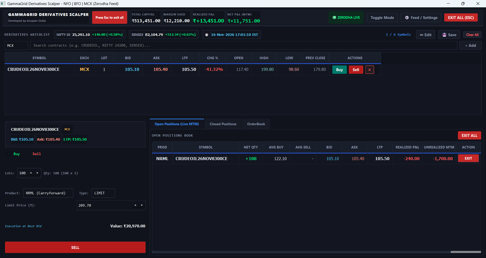

<div class="simulator-header" style="margin-bottom: 28px;">
  <div style="display: flex; gap: 8px; flex-wrap: wrap; margin-bottom: 12px;">
    <span style="background: rgba(56,189,248,0.15); border: 1px solid #38bdf8; color: #38bdf8; padding: 4px 10px; border-radius: 9999px; font-size: 12px; font-family: monospace; font-weight: bold;">
      OPEN SOURCE
    </span>
    <span style="background: rgba(34,197,94,0.15); border: 1px solid #22c55e; color: #4ade80; padding: 4px 10px; border-radius: 9999px; font-size: 12px; font-family: monospace; font-weight: bold;">
      MIT LICENSE
    </span>
    <span style="background: rgba(168,85,247,0.15); border: 1px solid #a855f7; color: #c084fc; padding: 4px 10px; border-radius: 9999px; font-size: 12px; font-family: monospace; font-weight: bold;">
      PYTHON 3 • PYQT6
    </span>
    <span style="background: rgba(251,191,36,0.15); border: 1px solid #f59e0b; color: #fbbf24; padding: 4px 10px; border-radius: 9999px; font-size: 12px; font-family: monospace; font-weight: bold;">
      NSE NFO • BSE BFO • MCX
    </span>
  </div>

  <p style="font-size: 16px; color: #cbd5e1; line-height: 1.6; margin-top: 6px;">
    <strong>GammaGrid Derivatives Scalper</strong> is an open-source, high-performance desktop options trading and simulation terminal built in Python and PyQt6. Designed for disciplined scalpers and quantitative traders, it connects directly to live market feeds using a <strong>free, read-only Zerodha Kite session (<code style="color:#38bdf8;">enctoken</code>)</strong> with zero API subscription charges, or operates in an offline synthetic simulation feed for testing and practice.
  </p>

  <div style="margin-top: 18px; display: flex; gap: 12px; flex-wrap: wrap;">
    <a href="https://github.com/anupamdutta/PythonProject" target="_blank" rel="noopener noreferrer"
       style="display: inline-flex; align-items: center; gap: 8px; background: #0284c7; border: 1px solid #38bdf8; color: #ffffff; padding: 9px 18px; border-radius: 6px; text-decoration: none; font-family: monospace; font-size: 14px; font-weight: bold; box-shadow: 0 0 14px rgba(56,189,248,0.4); transition: 0.2s;">
      <svg height="18" width="18" viewBox="0 0 16 16" fill="currentColor" style="vertical-align: middle;">
        <path d="M8 0C3.58 0 0 3.58 0 8c0 3.54 2.29 6.53 5.47 7.59.4.07.55-.17.55-.38 0-.19-.01-.82-.01-1.49-2.01.37-2.53-.49-2.69-.94-.09-.23-.48-.94-.82-1.13-.28-.15-.68-.52-.01-.53.63-.01 1.08.58 1.23.82.72 1.21 1.87.87 2.33.66.07-.52.28-.87.51-1.07-1.78-.2-3.64-.89-3.64-3.95 0-.87.31-1.59.82-2.15-.08-.2-.36-1.02.08-2.12 0 0 .67-.21 2.2.82.64-.18 1.32-.27 2-.27.68 0 1.36.09 2 .27 1.53-1.04 2.2-.82 2.2-.82.44 1.1.16 1.92.08 2.12.51.56.82 1.27.82 2.15 0 3.07-1.87 3.75-3.65 3.95.29.25.54.73.54 1.48 0 1.07-.01 1.93-.01 2.2 0 .21.15.46.55.38A8.013 8.013 0 0016 8c0-4.42-3.58-8-8-8z"/>
      </svg>
      GitHub Repository (PythonProject) ↗
    </a>

    <a href="#installation"
       style="display: inline-flex; align-items: center; gap: 8px; background: rgba(15,23,42,0.8); border: 1px solid rgba(56,189,248,0.3); color: #38bdf8; padding: 9px 18px; border-radius: 6px; text-decoration: none; font-family: monospace; font-size: 14px; transition: 0.2s;">
      Quickstart &amp; Setup ↓
    </a>
  </div>
</div>

<!-- ================= TERMINAL SCREENSHOT ================= -->
<div style="margin: 28px 0; text-align: center;">
  <div style="position: relative; display: inline-block; width: 100%; max-width: 920px;">
    
  </div>
  <p style="margin-top: 10px; font-size: 13px; color: #94a3b8; font-family: monospace;">
    GammaGrid Derivatives Scalper — Multi-Contract Level-2 Depth, Real-Time Bid/Ask Spread Execution &amp; Paper Trading Terminal
  </p>
</div>

---

## Why an Option Trading Simulator?

Real market execution in derivatives scalping is governed by **bid-ask spreads, order book liquidity, and execution latency**. Most paper trading tools fail because they assume fills occur at the Last Traded Price (LTP) without slippage.

**GammaGrid Derivatives Scalper** addresses this directly:
- **Buy orders** fill against real-time **Best Ask** prices.
- **Sell orders** fill against real-time **Best Bid** prices.
- **Open positions** are continuously marked to market (MTM) based on immediate liquidity depth.

This realistic microstructure modeling gives quants, algorithmic traders, and discretionary scalpers a rigorous sandbox to hone execution discipline before risking real capital.

---

## Key Features & Capabilities

<div style="display: grid; grid-template-columns: repeat(auto-fit, minmax(280px, 1fr)); gap: 16px; margin: 20px 0;">

  <div style="background: rgba(15,23,42,0.7); border: 1px solid rgba(56,189,248,0.25); border-radius: 8px; padding: 18px;">
    <div style="color: #38bdf8; font-family: monospace; font-weight: bold; font-size: 14px; margin-bottom: 8px;">
      [ 1. FOCUSED 6-CONTRACT WATCHLIST ]
    </div>
    <p style="font-size: 13px; color: #cbd5e1; margin: 0; line-height: 1.5;">
      Enforces a strict 6-symbol limit to prevent cognitive overload. Displays full Level-2 market depth (Best Bid in Cyan, Best Ask in Coral, LTP, Change %, Open, High, Low, and Previous Close) with custom saved profiles.
    </p>
  </div>

  <div style="background: rgba(15,23,42,0.7); border: 1px solid rgba(56,189,248,0.25); border-radius: 8px; padding: 18px;">
    <div style="color: #38bdf8; font-family: monospace; font-weight: bold; font-size: 14px; margin-bottom: 8px;">
      [ 2. REALISTIC SPREAD EXECUTION ]
    </div>
    <p style="font-size: 13px; color: #cbd5e1; margin: 0; line-height: 1.5;">
      Simulates institutional fills with actual market friction. Supports Market and Limit orders, Intraday (MIS) and Carryforward (NRML) margins, and live position liquidation against real book depth.
    </p>
  </div>

  <div style="background: rgba(15,23,42,0.7); border: 1px solid rgba(56,189,248,0.25); border-radius: 8px; padding: 18px;">
    <div style="color: #38bdf8; font-family: monospace; font-weight: bold; font-size: 14px; margin-bottom: 8px;">
      [ 3. ZERO-COST LIVE ZERODHA FEED ]
    </div>
    <p style="font-size: 13px; color: #cbd5e1; margin: 0; line-height: 1.5;">
      Connects to Zerodha's streaming WebSocket (<code>wss://ws.zerodha.com</code>) using binary packet unpacking powered by your personal read-only web session token (<code>enctoken</code>) — zero API charges required.
    </p>
  </div>

  <div style="background: rgba(15,23,42,0.7); border: 1px solid rgba(56,189,248,0.25); border-radius: 8px; padding: 18px;">
    <div style="color: #38bdf8; font-family: monospace; font-weight: bold; font-size: 14px; margin-bottom: 8px;">
      [ 4. 220,000+ CONTRACT DIRECTORY ]
    </div>
    <p style="font-size: 13px; color: #cbd5e1; margin: 0; line-height: 1.5;">
      Automatically downloads and caches Zerodha's daily instrument master. Features instant keyboard autocomplete (<code>QCompleter</code>) for all NSE F&amp;O, BSE Sensex/Bankex, and MCX Commodity options and futures.
    </p>
  </div>

  <div style="background: rgba(15,23,42,0.7); border: 1px solid rgba(56,189,248,0.25); border-radius: 8px; padding: 18px;">
    <div style="color: #38bdf8; font-family: monospace; font-weight: bold; font-size: 14px; margin-bottom: 8px;">
      [ 5. PERSISTENT STATE ENGINE ]
    </div>
    <p style="font-size: 13px; color: #cbd5e1; margin: 0; line-height: 1.5;">
      Open positions, average entry prices, realized/unrealized P&amp;L, trade logs, and cash balances persist across restarts in <code>positions.json</code>, automatically reconnecting to live ticks upon launch.
    </p>
  </div>

  <div style="background: rgba(15,23,42,0.7); border: 1px solid rgba(56,189,248,0.25); border-radius: 8px; padding: 18px;">
    <div style="color: #38bdf8; font-family: monospace; font-weight: bold; font-size: 14px; margin-bottom: 8px;">
      [ 6. PANIC SAFETY SHORTCUT ]
    </div>
    <p style="font-size: 13px; color: #cbd5e1; margin: 0; line-height: 1.5;">
      One-touch emergency liquidation: pressing the <kbd style="background:#1e293b; color:#f87171; border:1px solid #f87171; border-radius:4px; padding:1px 6px; font-family:monospace;">Esc</kbd> key immediately squares off all active market positions at once during violent volatility surges.
    </p>
  </div>

</div>

---

<h2 id="installation">Installation &amp; Setup</h2>

### Prerequisites
- **Python 3.10+**
- **Git**

### 1. Clone the Open-Source Repository
```bash
git clone https://github.com/anupamdutta/PythonProject.git
cd PythonProject
```

### 2. Install Required Python Packages
```bash
pip install -r requirements.txt
```

### 3. Launch the Terminal
```bash
python main.py
```
*(On Windows systems, you can also launch directly by double-clicking `run.bat`)*

---

## Connecting Free Live Zerodha Market Data

The terminal can stream live ticks directly from Zerodha Kite without any Kite Connect developer API fees (saving ₹2,000/month):

1. Log into your account at **[kite.zerodha.com](https://kite.zerodha.com)** in Google Chrome or Microsoft Edge.
2. Press <kbd style="background:#1e293b; color:#38bdf8; border:1px solid #38bdf8; border-radius:4px; padding:1px 6px; font-family:monospace;">F12</kbd> (Developer Tools) &rarr; Select the **Application** tab &rarr; Expand **Cookies** &rarr; Select `https://kite.zerodha.com`.
3. Locate the cookie named **`enctoken`** and copy its string value.
4. In **GammaGrid Scalper**, navigate to:
   - **`⚙ Feed / Settings`** &rarr; Select **`Zerodha Live Feed`**
   - Paste your token into the **Enctoken** field
   - Click **`Test Zerodha Connection`** &rarr; **`Save & Apply`**
5. The terminal status bar will indicate: <span style="color:#4ade80; font-family:monospace; font-weight:bold;">Feed: Connected (Live Zerodha Ticks Active)</span>.

---

## Open Source Repository & Contributions

This simulator is maintained as a free and open-source project under the **MIT License**. We welcome pull requests, feature suggestions, and quantitative feedback from the derivative trading community.

- **GitHub Repository**: [https://github.com/anupamdutta/PythonProject](https://github.com/anupamdutta/PythonProject)
- **Author**: Anupam Dutta ([@gammagrid](https://www.threads.net/@gammagrid))
- **License**: MIT License
