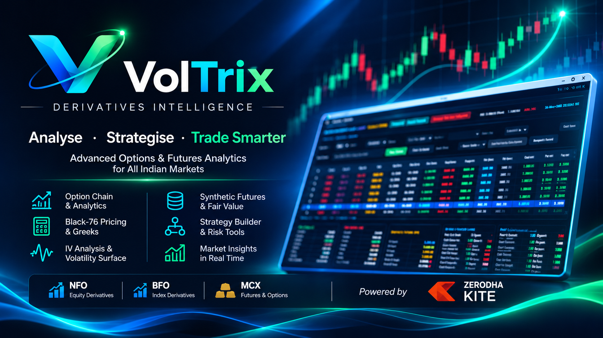

  

    
      PROPRIETARY TRADING TERMINAL
    
    
      BLACK-76 PRICING ENGINE
    
    
      LIVE ZERODHA KITE FEED
    
    
      WINDOWS 10 / 11 (64-BIT)
    
    
      REQUEST-ONLY DISTRIBUTION
    
  

  

    <strong>VolTrix Commercial</strong> is an institutional-grade live option chain analytics terminal built around independent Synthetic Future (SF) modeling, real-time Black-76 derivatives pricing, and live WebSocket market feeds via Zerodha Kite. Engineered for professional derivatives traders, quants, and options analysts who require precision — not approximation.
  

  

    <a href="#contact"
       style="display: inline-flex; align-items: center; gap: 8px; background: linear-gradient(135deg, #0e7490 0%, #0369a1 100%); border: 1px solid #38bdf8; color: #ffffff; padding: 10px 22px; border-radius: 6px; text-decoration: none; font-family: monospace; font-size: 14px; font-weight: bold; box-shadow: 0 0 16px rgba(56,189,248,0.4);">
      Request Access →
    </a>
    <a href="#licensing"
       style="display: inline-flex; align-items: center; gap: 8px; background: rgba(15,23,42,0.8); border: 1px solid rgba(56,189,248,0.3); color: #38bdf8; padding: 10px 18px; border-radius: 6px; text-decoration: none; font-family: monospace; font-size: 14px;">
      Licensing &amp; Pricing ↓
    </a>
  

<!-- ================= BANNER ================= -->

  

    
  

  

    VolTrix Commercial — Real-Time Multi-Strike Synthetic Futures, Black-76 IV Engine &amp; Live Option Chain Terminal
  

---

## The Quantitative Framework

Standard option chain displays show raw LTP. VolTrix goes deeper.

For every active strike, VolTrix derives an **independent Synthetic Future**:

$$\text{SF} = \text{Strike} + \text{Call Price} - \text{Put Price}$$

This isolates localized put-call parity deviations and structural order-book imbalances at each strike — independent of the index spot price. The engine then deploys a **Black-76 model** against this per-strike forward to compute:

- High-precision **Black-76 Implied Volatilities** (Call IV, Put IV, Open IV)
- Real-time **Delta, d1, d2** Greeks and dealer hedging sensitivity
- **Resistance & Support** boundary levels derived from option Greeks
- **Projected SF High / SF Low** levels based on open-price delta expansion
- **IV Advice Alerts** — Elevated (Avoid Selling) / Collapsed (Avoid Buying)
- **Strategy Conclusion Engine** — Fixed & Variable Delta Dominance logic

---

## Core Features

### ⟶ Live Zerodha Kite Integration
Full Level-2 WebSocket feed. Real-time LTP, ATP, OI, Bid/Ask, and Open prices stream directly into the pricing engine. No manual refresh. No delayed snapshots.

### ⟶ Multi-Exchange Coverage
- **NFO** — NSE Equity F&O (Nifty, BankNifty, Sensex, Midcap, FinNifty, etc.)
- **BFO** — BSE Equity F&O
- **MCX** — Commodity Derivatives (CrudeOil, Gold, Silver, Natural Gas, etc.)

### ⟶ Configurable Session Times
Open and close times for each exchange are user-configurable. If MCX opens at 17:00 on a modified session day, the DTE fraction and Open IV calculations automatically adapt — no manual correction required.

### ⟶ Dynamic DTE Engine
Two operating modes:
- **Fixed Mode** — DTE = (Expiry − Today) + session fraction
- **Reducing to Close** — Intraday fraction decays continuously toward 0 at market close

Both modes dynamically derive the session fraction from your configured open/close times.

### ⟶ SF Open Analytics
Captures the first-tick open prices for the underlying and options at market open. From these, it computes **SF Open**, **Open IV**, **Open Greeks**, **Projected SF High**, and **Projected SF Low** — giving you a structural view of the day before it unfolds.

### ⟶ Precision Strike Ladder
A live 17-column option chain table covering:
Call LTP, IV, Delta, Bid/Ask, OI — Strike — Put LTP, IV, Delta, Bid/Ask, OI — SF, SF Open, Projected Levels

---

## Who Is This For

VolTrix Commercial is designed exclusively for:

- **Active F&O traders** who require real-time structural edge over raw chain data
- **Proprietary trading desks** running intraday derivatives strategies
- **Quantitative researchers** studying put-call parity dislocations and IV behavior
- **Options analysts** who need precise Greeks and forward valuations — not estimates

This is **not** a retail screener. This is a professional derivatives pricing terminal.

---

<h2 id="licensing">Licensing &amp; Subscription</h2>

> [!IMPORTANT]
> VolTrix Commercial is a **licensed proprietary software terminal**. It is distributed exclusively on request. An **active monthly subscription** is required for operation.

### Licensing Architecture

- **Machine-Locked License** — Each license is tied to the authorized machine's unique hardware identifier (HWID). Non-transferable.
- **Monthly Subscription** — Required for continued software operation and engine updates. Subscription lapses terminate access.
- **Zerodha Kite Prerequisite** — An active Zerodha trading account with API access is required to stream live market data.
- **Onboarding** — Upon approval, you will receive an activation key linked to your registered email and machine.

### Subscription Pricing

  <table style="width: 100%; border-collapse: collapse; background: rgba(15, 23, 42, 0.85); border: 1px solid rgba(56, 189, 248, 0.3); border-radius: 8px; overflow: hidden;">
    <thead>
      <tr style="background: rgba(2, 132, 199, 0.2); border-bottom: 1px solid rgba(56, 189, 248, 0.35);">
        <th style="padding: 12px 16px; text-align: left; color: #38bdf8; font-family: monospace; font-size: 13px; border: none;">Plan</th>
        <th style="padding: 12px 16px; text-align: left; color: #38bdf8; font-family: monospace; font-size: 13px; border: none;">Duration</th>
        <th style="padding: 12px 16px; text-align: left; color: #38bdf8; font-family: monospace; font-size: 13px; border: none;">Coverage</th>
      </tr>
    </thead>
    <tbody>
      <tr style="background: transparent;">
        <td style="padding: 12px 16px; color: #f1f5f9; font-weight: bold; border-top: 1px solid rgba(56, 189, 248, 0.15); border-left: none; border-right: none; border-bottom: none;">Monthly</td>
        <td style="padding: 12px 16px; color: #cbd5e1; border-top: 1px solid rgba(56, 189, 248, 0.15); border-left: none; border-right: none; border-bottom: none;">1 month</td>
        <td style="padding: 12px 16px; color: #cbd5e1; border-top: 1px solid rgba(56, 189, 248, 0.15); border-left: none; border-right: none; border-bottom: none;">Full access — all exchanges, all features, engine updates</td>
      </tr>
    </tbody>
  </table>

> Pricing is disclosed on request. Contact directly to discuss terms.

---

<h2 id="contact">Contact &amp; Access Request</h2>

VolTrix Commercial is **not publicly listed for download**. Access is granted on a request basis after a brief onboarding discussion.

To request a **demo, license activation, or subscription**:

📧 **Email**: [dutta.anupam.02@gmail.com](mailto:dutta.anupam.02@gmail.com)  
☎️ **Phone / WhatsApp**: +91-8240775462  
💬 **Threads**: [@gammagrid](https://www.threads.net/@gammagrid)

  

    VOLTRIX COMMERCIAL — PROPRIETARY TERMINAL
  

  <h3 style="margin-top: 0; margin-bottom: 12px; color: #f8fafc; font-size: 20px;">
    Request Access or Demo
  </h3>
  

    Distribution is by request only. Reach out directly to discuss access, pricing, and onboarding.
    Active Zerodha API account required.
  

  <a href="mailto:dutta.anupam.02@gmail.com"
     style="display: inline-flex; align-items: center; gap: 10px; background: linear-gradient(135deg, #0e7490 0%, #0369a1 100%); border: 1px solid #38bdf8; color: #ffffff; padding: 13px 32px; border-radius: 8px; text-decoration: none; font-family: monospace; font-size: 15px; font-weight: bold; box-shadow: 0 0 20px rgba(56,189,248,0.45);">
    ✉ Contact Anupam Dutta
  </a>
  

    Request-Only Distribution &nbsp;•&nbsp; Monthly Subscription Required &nbsp;•&nbsp; Machine-Locked License
  

---

## System Requirements

- **OS**: Windows 10 (64-bit) or Windows 11 (64-bit)
- **Architecture**: x64-based processor
- **RAM**: 4 GB minimum (8 GB recommended)
- **Display**: 1920 × 1080 (Full HD) or higher recommended
- **Market Data**: Active Zerodha trading account with Kite Connect API access
- **Prerequisite Knowledge**: Black-76 / Black-Scholes pricing, Synthetic Futures, IV structure, Indian F&O market conventions

---

VolTrix Commercial is proprietary software developed and maintained by Anupam Dutta, VolTrix Systems, Howrah.
Unauthorized copying, redistribution, or reverse engineering is strictly prohibited.
All rights reserved.

